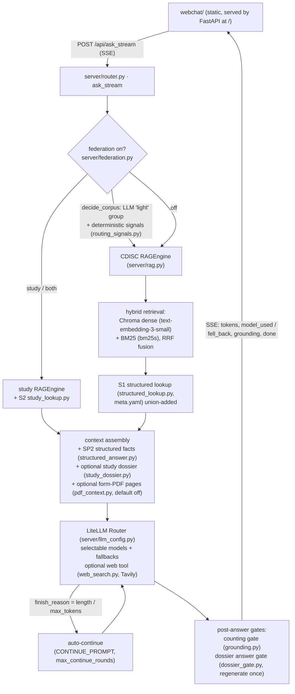

# Architecture

How a question flows through sdtm-rag. Everything here comes from the code under `server/`, `scripts/`, `eval/` and `deploy/`. Module names are the source of truth.

## Request flow (`POST /api/ask_stream`)

### Stages

| Stage | Module | What it does |
|---|---|---|
| Entry | `server/main.py` | FastAPI app; lifespan warms the engines; serves `webchat/` at `/` and `/static`; `install_security` adds an optional login gate and rate limit (off by default) plus security headers (on by default) |
| Routes | `server/router.py` | `/api/ask`, `/api/ask_stream`, `/api/ask_compare`, `/api/validate`, `/api/validate-study`, `/api/flag`, `/api/info`, `/api/health` |
| Corpus routing | `server/federation.py` | Two `RAGEngine`s (CDISC KB, optional study corpus). `decide_corpus` uses the LLM `light` group with strict-JSON whitelist validation; any error falls back to "both". Results from "both" are merged by per-corpus quota, not by cross-corpus score |
| Retrieval | `server/rag.py` | Dense Chroma search plus BM25 over the same chunks, fused with RRF (or weighted). The S1 structured lookup adds deterministic hits for CT codes and variable/domain relationships that embeddings miss |
| Study lookup | `server/study_lookup.py` | S2 deterministic lookup over the study `catalog.json` (label substring, OID segment, form scope). It never guesses: if no channel fires, plain retrieval is used |
| LLM | `server/llm_config.py` | LiteLLM `Router` with internal groups (`default` / `hard` / `light`) and the user-selectable models (`selectable_models` in `server/config.py`). Fallbacks are reported back to the UI (`fell_back`, `merge_reported_model`), so the answer shows which model actually answered |
| Web reference | `server/web_search.py` | Optional Tavily tool calls; at most `web_max_rounds` rounds, and the final round runs without tools. Failure status reaches the UI and is never silent |
| Gates | `server/grounding.py`, `server/dossier_gate.py` | Deterministic, no LLM. The counting gate appends a correction when the answer contradicts the structured counts. The dossier gate checks OIDs and coverage when the study dossier is attached, and regenerates once on failure |

## Knowledge graph and validator

- `data/meta/meta.yaml` is the structured graph: classes, domains, variables, codelists and relations. `scripts/build_meta.py` builds it from the KB, and `server/meta_store.py` / `server/graph_engine.py` load it into memory (no Neo4j at runtime).
- `server/graph_answer.py` and `server/structured_answer.py` turn graph facts into answer context (SP2/SP3).
- `server/graph_validator.py` runs advisory cross-domain checks for an uploaded study (`POST /api/validate-study`), next to the rule validator `server/validator.py` (`POST /api/validate`).
- `scripts/mine_implicit_relations.py` writes `data/meta/implicit_relations.json`: advisory edges, each backed by a verbatim KB quote. It never writes to `meta.yaml`.
- KG viewer: `scripts/build_kg_viewer.py` inlines `viewer/{template.html,style.css,layout.mjs,app.js}` and the graph data into `viewer/dist/kg_viewer.html`, a single offline HTML file. Never edit the generated file by hand.

## Data and ingest

- The CDISC KB is the submodule `vendor/sdtm-pedia` ([hakupao/sdtm-pedia](https://github.com/hakupao/sdtm-pedia)). `settings.kb_root` defaults to `vendor/sdtm-pedia/knowledge_base`.
- `scripts/ingest.py` chunks the KB (`scripts/chunkers/`), embeds the chunks with OpenAI `text-embedding-3-small` via LiteLLM, and writes Chroma collection `sdtm_kb_v1` under `data/chroma/` (gitignored). Chunk ids and `source` metadata are KB-relative paths.
- The optional study corpus lives only in gitignored `data/study/`. `scripts/study/` holds its build pipeline. A red-line rule keeps real study OIDs and labels out of git; the pre-commit hook `.githooks/pre-commit` runs `scripts/precommit_oidscan.py` to enforce it.

## Evaluation harness (`eval/`)

- `eval/run_eval.py` runs a gold question set. `--retrieval-only` makes zero LLM answer calls and scores per-question source recall. Gold sets: `eval/test_set_v3.yml` (CDISC, 140 questions), plus study sets under `data/study/` (private).
- `eval/lint_gold.py` checks study gold integrity, `eval/run_routing_eval.py` checks the corpus router, and `eval/prod_wirein/check_code_grounding.py` is the offline CT-code grounding checker.
- Unit tests live in `tests/` (pytest; `-m "not slow"` is the CI set; `local_data` tests auto-skip without `data/study/`). Front-end tests: `node --test webchat/tests/*.test.mjs`.

## Deploy

- Container image: `deploy/container/Dockerfile`. The build context is the repo root, and only the KB part of the submodule is copied in. `deploy/container/compose.yml` runs `api` (8000) and the Streamlit debug UI `ui` (8501). `data/` and `.env` are mounted at runtime and never baked into the image.
- CI/CD: `.gitea/workflows/sdtm-rag.yml` runs on push to `main`. It tests, builds, pushes the image, deploys, health-checks, and rolls back automatically on failure. Procedure: [deploy/README.md](../deploy/README.md).
